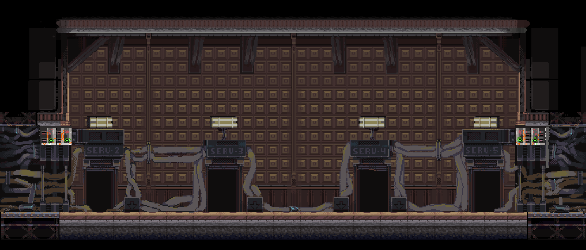
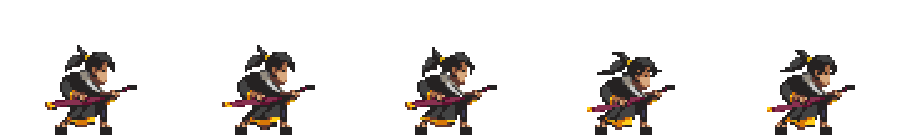

<div align="center">

# Battle with AI · 动作对战

结合角色动画、敌人状态机和子弹时间的 C++ 游戏练习。

  

</div>

---

## 项目亮点

- 玩家移动、跳跃、翻滚与鼠标定向攻击。
- 敌人状态节点与状态机组织 AI 行为。
- 碰撞盒、碰撞层与角色管理模块。
- 子弹时间、逐帧动画、音效与生命值显示。

这里的 AI 指游戏中的敌人行为逻辑。

## 资源预览

下方图片直接引用本仓库已有资源，用于展示项目中的场景和角色，属于素材预览。角色、美术和音乐的权利归各自权利人所有；仓库提供素材不代表授予额外使用许可。


<p align="center"></p>
<p align="center"></p>

## 操作

| 动作 | 按键 |
| --- | --- |
| 左右移动 | A / D |
| 跳跃 | W 或空格 |
| 翻滚 | S |
| 攻击 | 鼠标左键，方向由鼠标位置确定 |
| 子弹时间 | 按住鼠标右键进入，松开退出 |

## 本地运行

环境：Windows、Visual Studio C++ 桌面开发工具、与目标架构匹配的 EasyX。工程使用的工具集以 `.vcxproj` 为准；本机版本不同可在项目属性中重定向。

```sh
git clone --branch master https://github.com/wek486/Battle-with-AI.git
cd Battle-with-AI
```

1. 打开 `kong.cpp.slnx`，选择相应平台和编译配置。
2. 确认 EasyX 的头文件与库已配置，再生成项目。
3. 工作目录设为仓库根目录，保留 `resources/` 图片与音频目录。

以上是按仓库代码整理的运行步骤，未在此次文档整理中完成编译验证。

## 代码导览

| 模块 | 职责 |
| --- | --- |
| `main.cpp` | 初始化、输入分发、更新与绘制 |
| `player.cpp`、`player_state_nodes.cpp` | 玩家输入与状态 |
| `enemy.cpp`、`enemy_state_nodes.cpp` | 敌人行为 |
| `state_machine.*` | 状态切换 |
| `collision_manager.*` | 碰撞管理 |
| `resources_manager.*` | 图片、动画与音频资源 |
| `bullent_time_manager.cpp` | 子弹时间更新；文件名按仓库实际拼写保留 |

---

如果你也在学习这个方向，欢迎通过 Issues 交流思路、反馈问题。遇到不理解的实现，可以结合代码与 AI 提问，先理解，再动手修改。
